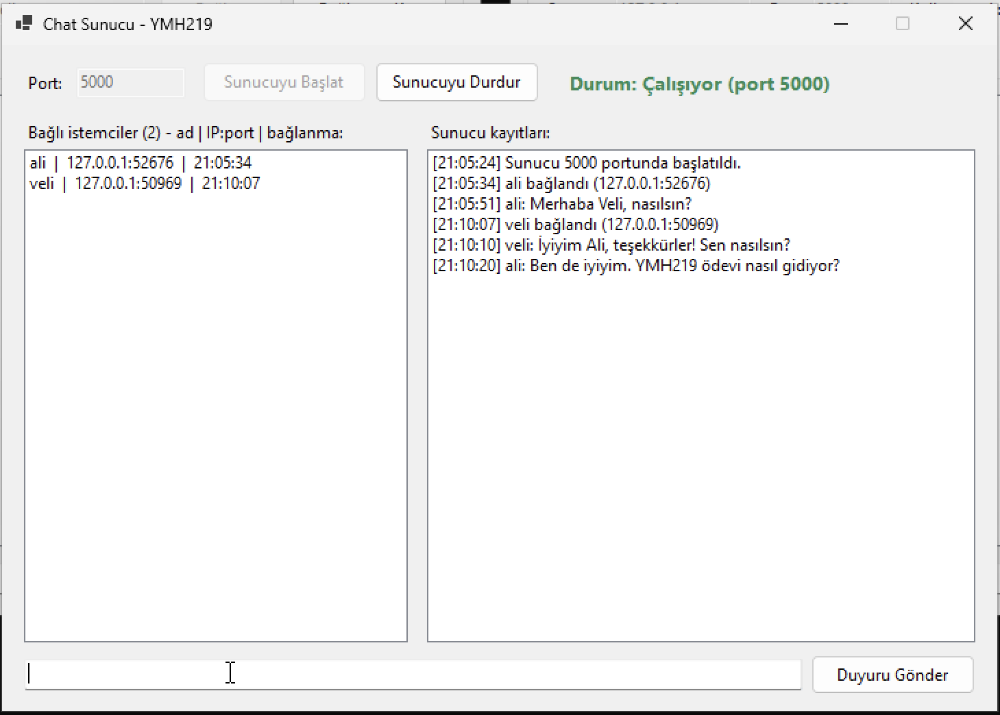
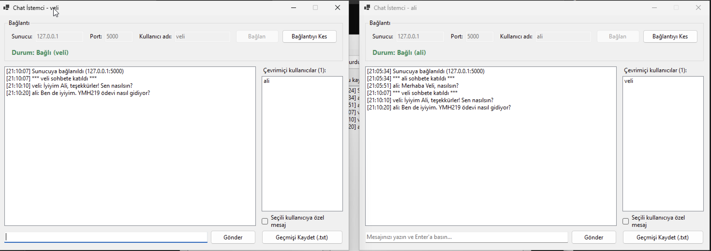

# YMH219 - Chat Uygulaması (İstemci-Sunucu)

TCP/IP üzerinden çalışan basit bir sohbet uygulaması. Bir **sunucu** uygulaması ve birden fazla açılabilen **istemci** uygulamasından oluşuyor. İstemciler kullanıcı adıyla bağlanıp ortak odada mesajlaşabiliyor veya birbirine özel mesaj gönderebiliyor.

**Öğrenci:** Miraç Özcan AĞCABAY - Öğrenci No: 250541002

## Kullanılan Teknolojiler

- C# / .NET 8, Windows Forms
- `TcpListener`, `TcpClient`, `NetworkStream`
- `StreamReader` / `StreamWriter`
- `async` / `await` ile asenkron okuma-yazma
- Harici NuGet paketi yok

## Proje Yapısı

Çözüm (`ChatApp.sln`) üç projeden oluşuyor:

| Proje | Açıklama |
|---|---|
| `ChatOrtak` | Sunucu ve istemcinin ortak kullandığı `Mesaj` sınıfı ve `MesajTipi` enum'u (sınıf kütüphanesi) |
| `ChatServer` | `Sunucu` (dinleme, mesaj dağıtma), `BagliIstemci` (bağlı her istemcinin bilgisi), sunucu formu |
| `ChatClient` | `ChatIstemci` (bağlanma, gönderme, dinleme), istemci formu |

### Mesaj Protokolü

Her mesaj tek satır olarak gönderiliyor:

```
Tip|Gonderen|Hedef|ZamanTicks|Icerik
```

Örnek: `Sohbet|ali||639311489910337750|merhaba`

Mesaj tipleri: `Giris`, `Sohbet`, `Ozel`, `Sistem`, `Liste`, `Hata`, `Cikis`

## Kurulum ve Çalıştırma

1. Depoyu klonlayın:
   ```bash
   git clone https://github.com/magcabay/YMH219-ChatApp.git
   ```
2. `ChatApp.sln` dosyasını Visual Studio 2022 ile açın.
3. Solution'a sağ tıklayın → **Configure Startup Projects** → **Multiple startup projects** seçip `ChatServer` ve `ChatClient` için **Start** seçin.
4. `F5` ile çalıştırın.
5. Sunucu penceresinde port (varsayılan 5000) girip **Sunucuyu Başlat**'a basın.
6. İstemci penceresinde sunucu adresi (`127.0.0.1`), port ve kullanıcı adı girip **Bağlan**'a basın.
7. İkinci bir istemci açmak için `ChatClient\bin\Debug\net8.0-windows\ChatClient.exe` dosyasını tekrar çalıştırabilirsiniz.

Komut satırından:
```bash
dotnet run --project ChatServer
```
```bash
dotnet run --project ChatClient
```

> Farklı bilgisayarlardan bağlanmak için istemcide sunucu bilgisayarın yerel IP adresini (ör. `192.168.1.20`) yazın. Windows Güvenlik Duvarı ilk açılışta izin isteyebilir.

## Özellikler

**Sunucu**
- Port seçip başlatma / durdurma, durum göstergesi
- Bağlı istemcilerin listesi (kullanıcı adı, IP:port, bağlanma saati)
- Sunucu kayıtları (bağlanma, ayrılma, mesajlar)
- Tüm istemcilere duyuru gönderme
- Aynı kullanıcı adıyla ikinci bağlantıyı reddetme

**İstemci**
- Kullanıcı adı ile bağlanma, **Bağlan / Gönder / Bağlantıyı Kes**
- Gönderilen ve alınan mesajlar saat bilgisiyle listeleniyor
- Çevrimiçi kullanıcılar listesi ve seçili kullanıcıya özel mesaj
- Sohbet geçmişini `.txt` dosyasına kaydetme
- Sunucu kapalıysa, bağlantı koparsa ya da zaman aşımı olursa uygulama kapanmadan hata mesajı gösteriliyor

## Ekran Görüntüleri





## Bilinen Sınırlamalar / Geliştirme Notları

- Mesajlar şifrelenmeden düz metin olarak gönderiliyor, sadece yerel ağda ders amaçlı kullanım için uygun.
- Tek bir ortak oda var, birden fazla oda desteği yok.
- Mesaj içindeki satır sonları boşluğa çevriliyor (protokol satır tabanlı olduğu için).
